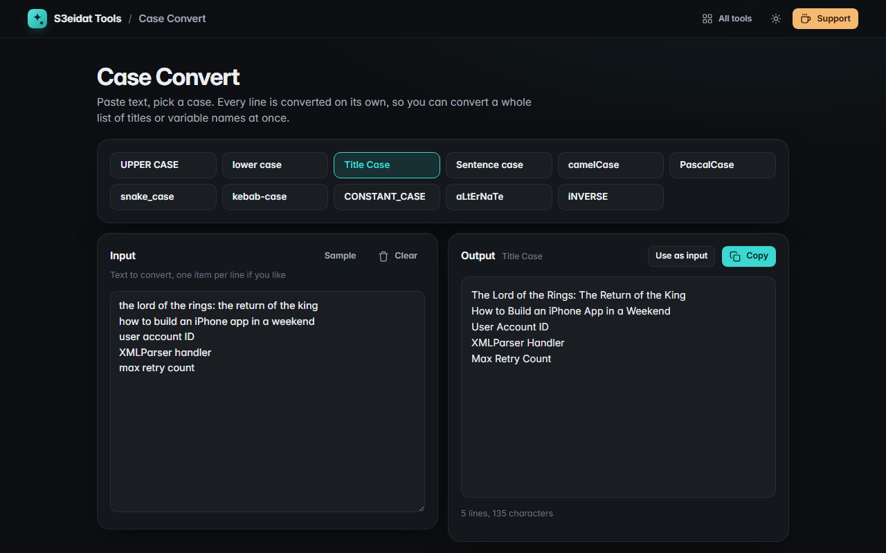

# Case Convert

> UPPER, lower, Title, camelCase, snake_case and more. Free, private, and it runs entirely in your browser.

### ▶ [Open Case Convert](https://s3eidat.github.io/case-convert/)



## Features

- **UPPER CASE**, **lower case**, **Sentence case** (also fixes a lone “i” to “I”)
- **Title Case** that keeps small words (a, of, the, and…) lower case except at the start, the end or after a colon,
  capitalises both halves of hyphenated words, keeps names like *iPhone* and *NASA*, and fixes ALL-CAPS input
- Code cases: **camelCase**, **PascalCase**, **snake_case**, **kebab-case**, **CONSTANT_CASE**; they split
  existing camelCase and acronyms (`XMLParser` → `xml_parser`)
- Fun ones: **aLtErNaTe** and **iNVERSE**
- Works **line by line**, so you can convert a whole list at once
- Unicode-aware (`café`, `Straße`); Arabic has no letter case, so Arabic text passes through unchanged
- Copy the result, or use it as the new input to chain conversions

## Privacy

Your text never leaves your device. There is no server, no account, no analytics.
The page ships with a strict Content-Security-Policy (`connect-src 'self'`), so the browser
itself blocks any attempt to send data anywhere.

## Run it yourself

It's plain HTML, CSS and JavaScript with no build step:

```bash
git clone https://github.com/s3eidat/case-convert
cd case-convert
python -m http.server 8000
```

Then open http://localhost:8000.

## Support

If this saved you time, **[buy me a coffee ☕](https://s3eidat.github.io/coffee/)**. It keeps every tool free.

---

Part of **[S3eidat Tools](https://s3eidat.github.io/)**: 100+ free, private tools that run in your browser. MIT licensed.
